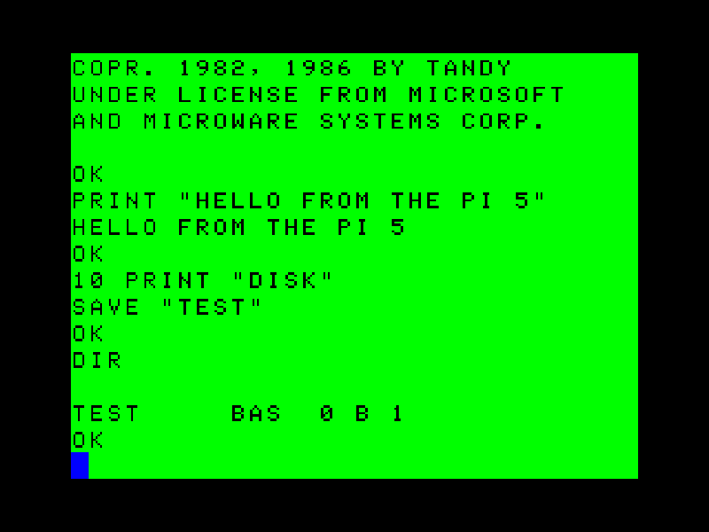
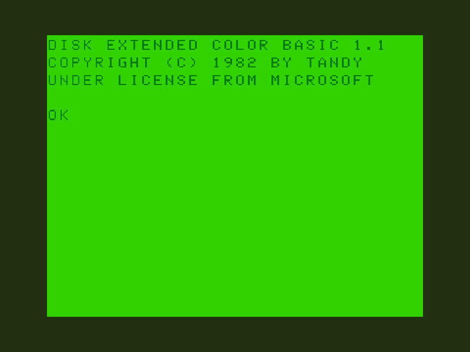
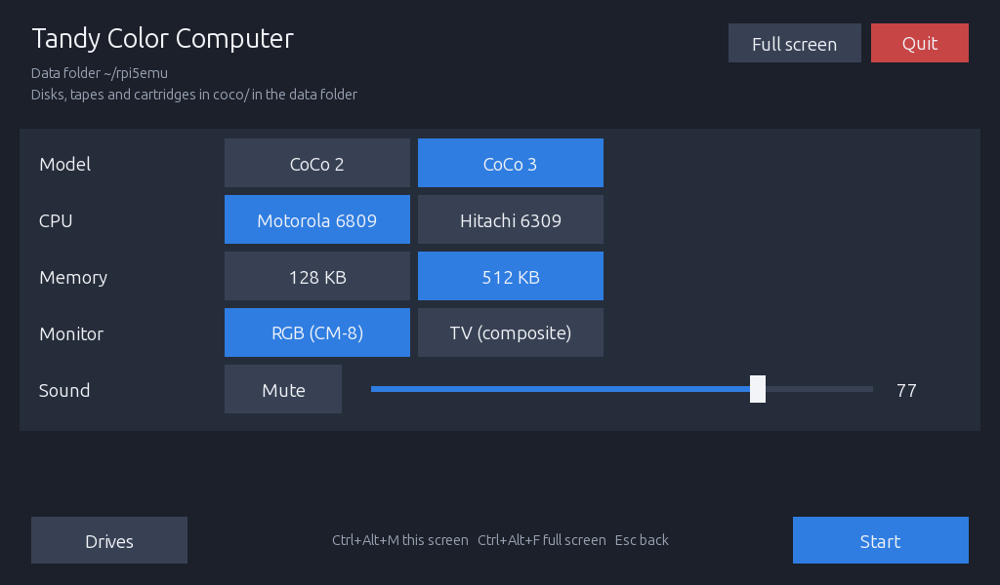
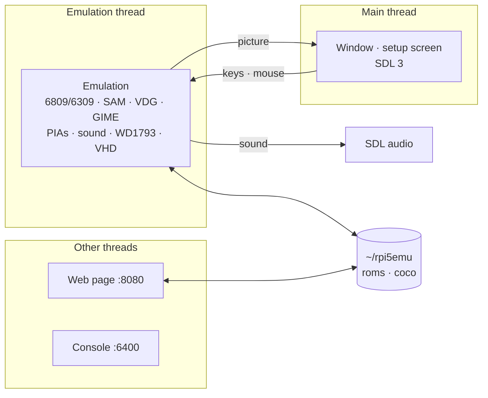

<h1 align="center">rpi5coco</h1>

<p align="center">
  <b>A Tandy Color Computer 2 or 3 on the Raspberry Pi 5, in a window of its own.</b><br>
  6809 or Hitachi 6309, the VDG and the GIME, cartridges, cassettes, floppies and an OS-9 hard disk.
</p>

<p align="center">
  
  
  
  
  
</p>

<p align="center">
  <b>Work in progress:</b> not everything has been tested, and games and demos may or may not
  work satisfactorily.
</p>

<p align="center">
  
  
  <br>
  <sub>The CoCo 3 saving a program to a new disk, and the CoCo 2, on the Pi.</sub>
</p>

rpi5coco runs [esp32coco](https://github.com/rlucencic/esp32coco)'s CoCo on a Raspberry Pi 5 with
64-bit Linux, in a window of its own (X11 or Wayland, through SDL 3). The machine is the
same code as on the ESP32 boards: esp32coco's platform-independent core and
[esp32emu](https://github.com/rlucencic/esp32emu)'s CPU core, on
[rpi5emu](https://github.com/rlucencic/rpi5emu), the family's Linux runtime: a setup
screen in the window, sound, the Pi's keyboard and mouse, a web page on your network and a
console.

It's one of the rpi5 family, the Raspberry Pi versions of the esp32 emulators:
[rpi5zx](https://github.com/rlucencic/rpi5zx) (ZX Spectrum),
[rpi5cpc](https://github.com/rlucencic/rpi5cpc) (Amstrad CPC),
[rpi5cbm](https://github.com/rlucencic/rpi5cbm) (Commodore 64 and 128),
[rpi5gs](https://github.com/rlucencic/rpi5gs) (Apple IIGS),
[rpi5msx](https://github.com/rlucencic/rpi5msx) (MSX1 and MSX2),
[rpi5xl](https://github.com/rlucencic/rpi5xl) (Atari 800XL and 130XE),
[rpi5ste](https://github.com/rlucencic/rpi5ste) (Atari STE),
[rpi5pc](https://github.com/rlucencic/rpi5pc) (IBM PC/XT and PC/AT),
[rpi5mac](https://github.com/rlucencic/rpi5mac) (Macintosh Plus, SE, Classic),
[rpi5mac2](https://github.com/rlucencic/rpi5mac2) (Macintosh LC and II),
[rpi5mac3](https://github.com/rlucencic/rpi5mac3) (Macintosh LC II and LC III),
[rpi5arc](https://github.com/rlucencic/rpi5arc) (Acorn Archimedes),
[rpi5ami](https://github.com/rlucencic/rpi5ami) (Amiga 500, 2000, 600, 1200).

## Features

**The machines**
- **Color Computer 2**: 64 KB, Color BASIC with Extended BASIC, at 0.89 MHz
  (1.79 MHz with the "speed-up poke")
- **Color Computer 3**: 128 or 512 KB, its own BASIC, 0.89 or 1.79 MHz
- **Motorola 6809 or Hitachi 6309**, chosen on the setup screen, as the
  6309 was fitted to many CoCos: in emulation mode it runs what a 6809
  does; software that knows it (NitrOS-9's 6309 version, programs that
  switch it to native mode) gets its extra registers (E, F, W, Q, V, MD),
  its instructions (register-to-register arithmetic, TFM block moves, bit
  operations, DIVD, DIVQ, MULD and the rest), its traps and its faster
  native mode. Both from one core with desktop conformance tests.

**The picture**
- **MC6847 VDG** (CoCo 2): text with its look (dark on green, inverse lower
  case), the semigraphics modes, all eight graphics modes up to PMODE 4, and
  PMODE 4's **artifact colours** as a TV shows them, in either phase or off;
  the SAM's video counter, so the semigraphics tricks that depend on it work
- **GIME** (CoCo 3): 32, 40, 64 and 80-column text with colour attributes,
  underline and blinking; graphics from 128×192 to 640×225 in 2, 4 or 16
  colours of 64; 192, 200 and 225 lines; horizontal and vertical scrolling;
  the palette on an **RGB monitor** (CM-8) or a **TV** (composite colours);
  the CoCo 2's modes through its palette (and lower case, as the MC6847T1
  it copies has it)
- **MMU** (CoCo 3): 8 KB blocks in two tasks, the ROM modes, constant RAM at
  `$FE00`; the GIME's timer and its interrupts (timer, borders, keyboard,
  cartridge), as IRQ or FIRQ

**Sound**: the 6-bit DAC and the single-bit sound, through the analogue
multiplexer as the CoCo has it (SOUND, PLAY, sampled sound, the tape's own
noise when you choose to hear it)

**Cartridges, tapes, disks**
- **Cartridges**: `.ROM`, `.CCC` and `.BIN` images up to 32 KB that start by
  themselves, as the real ones do through the CART line; or, in the same
  slot, the **disk controller** with Disk BASIC
- **Cassette**: `.CAS` tapes play into the cassette input as the tones they
  were (CLOAD and CLOADM read them as from a real tape), and **CSAVE** records
  onto them; fast loading runs the CoCo several times faster while the tape
  plays
- **Floppies**: two drives, a **WD1793** with Disk BASIC's HALT and NMI
  timing, `.DSK` images (JVC: RS-DOS and OS-9 disks, 35 or 40 tracks, one or
  two sides, 80 tracks), formatting with DSKINI, writes back to the image
- **Hard disk**: an SD-card image on the **VHD interface** that NitrOS-9's
  emulator driver (EmuDsk) uses: OS-9 runs from it, and writes go back to it
- **New blank media** from the setup screen or the web page: 156, 360 or
  720 KB floppies (formatted for Disk BASIC), a 32 MB hard disk, an empty
  tape

**Around it**
- **A window** of its own on the Pi's desktop (X11 or Wayland), resizable, full screen
  with Ctrl+Alt+F; the picture in the machine's shape, sharp pixels
- **Setup screen** in the window, first thing at start and any time with Ctrl+Alt+M:
  model, CPU, memory, monitor, the sound's volume, the drives and their images (insert, eject, new
  blank ones), Start / Back / Restart, Reset
- **The Pi's keyboard and mouse**: keys by position, as the boards' Bluetooth keyboards;
  a click in the window gives the mouse to the machine, Ctrl+Alt+G takes it back
- **Web page** at `http://<the Pi>:8080/`: drop images (or ZIP files) onto it, insert
  them, make blank ones, and watch the machine and its drives live
- **Sound** through SDL (PipeWire, PulseAudio or ALSA), the machine paced by the clock
- **Console** on the terminal and on `127.0.0.1:6400`: keys, typing, drives, screenshots

<p align="center">
  
  <br><sub>The setup screen in the window, before the CoCo starts</sub>
</p>

## Getting started

### 1. What you need

- A Raspberry Pi 5 with 64-bit Linux (developed on Ubuntu 26.04; any Linux with SDL 3.2 or
  later should do)
- The tools and libraries:
  `sudo apt install build-essential cmake ninja-build pkg-config libsdl3-dev libsdl3-ttf-dev libpng-dev`
- [esp32emu](https://github.com/rlucencic/esp32emu), [rpi5emu](https://github.com/rlucencic/rpi5emu)
  and [esp32coco](https://github.com/rlucencic/esp32coco), cloned next to this project
- The ROMs (below)

### 2. Build

```sh
git clone https://github.com/rlucencic/esp32emu.git
git clone https://github.com/rlucencic/rpi5emu.git
git clone https://github.com/rlucencic/esp32coco.git
git clone https://github.com/rlucencic/rpi5coco.git && cd rpi5coco
cmake -S . -B build -G Ninja && cmake --build build
```

### 3. ROMs

In the data folder's `roms/` (`~/rpi5emu/roms`), named as esp32coco's:
`bas13.rom` (or `bas12.rom`), `extbas11.rom`, `disk11.rom` (or
`disk10.rom`) for the CoCo 2, `coco3.rom` for the CoCo 3. Not part of this
repository.

### 4. First start

1. `build/rpi5coco`: the setup screen opens in a window.
2. Choose the model and click **Start**.
3. Put images into `~/rpi5emu/coco/`, drop them on the window or the web page, and
   insert them on the setup screen's **Disks** page.

## Using it

| To | Do |
|---|---|
| Get back to the setup screen | Ctrl+Alt+M (the machine waits meanwhile) |
| Full screen | Ctrl+Alt+F |
| Give the mouse to the machine, take it back | A click in the window; Ctrl+Alt+G |
| Run as fast as it goes (warp) | Ctrl+Alt+W, again for real speed |
| Take a screenshot | Ctrl+Alt+S (into `~/rpi5emu/screenshots`), or the console's `s` |
| Insert an image | The setup screen's **Disks** page, drop it on the window or the web page, or name it on the command line: `build/rpi5coco os9.dsk` |
| Start straight into the machine | `build/rpi5coco -S`, with the setup screen's rows as `--choice`: `build/rpi5coco -S --choice "Model=CoCo 2"` |
| Show the window on another computer | Log in with `ssh -C -Y <the Pi>` and start it there: fine for still pictures; games want the Pi's own monitor |
| Use a floppy | Insert it into **Floppy 0** or **1**, then `DIR`, `LOAD "NAME"`, `RUN "NAME"`; `DSKINI0` formats one |
| Boot OS-9 | NitrOS-9 EOU's `68EMU.DSK` (or `63EMU.DSK` with the 6309) in **Floppy 0** and its `.VHD` in **Hard disk**, CoCo 3 with 512 KB, then `DOS` |
| Load from a tape | Insert it into **Cassette**, then `CLOAD` (or `CLOADM` and `EXEC`) |
| Save to a tape | **New** next to **Cassette** (an empty tape), then `CSAVE "NAME"`; rewind it with the console's `w` or by inserting it again |
| Run a cartridge | Insert it into **Cartridge**: the CoCo starts again and runs it; eject it to get the disk controller back |

Images live in `~/rpi5emu/coco/`, settings in `~/.config/rpi5emu/settings.ini`; the
inserted images are remembered across starts. `build/rpi5coco --help` lists the options.

**Keyboard**: letters by position; digits and symbols by the character they
give on a US keyboard, with SHIFT as the CoCo needs it (Shift+' is ", which
is SHIFT+2 on the CoCo). Return is ENTER, Backspace and the cursor keys the
arrows, Esc or Pause BREAK, Home CLEAR, Caps Lock SHIFT+0 (the CoCo's
upper/lower case). Ctrl, Alt, F1 and F2 are the CoCo 3's CTRL, ALT, F1 and
F2. F5 is the reset button.

## How it works



- **[esp32coco](https://github.com/rlucencic/esp32coco)'s `components/coco`**: the CoCo,
  platform independent: the same code runs on the ESP32 boards.
- **`src/`**: the glue, esp32coco's `main/main.c` ported: memory, ROMs, settings, keyboard map,
  drives and status.
- **[rpi5emu](https://github.com/rlucencic/rpi5emu)**: the window, the setup screen, sound,
  input, the web page, the console, the data folder and the settings.
- **[esp32emu](https://github.com/rlucencic/esp32emu)**: the CPU core (6809 | 6309).

## Development

```sh
../rpi5emu/tools/pi.sh rpi5coco build        # from another computer: sync to the Pi, build there
../rpi5emu/tools/pi.sh rpi5coco run          # its window on this computer (ssh -C -Y)
../rpi5emu/tools/pi.sh rpi5coco headless     # no window: drive it through the console
../rpi5emu/tools/console.sh i 's /tmp/shot.png'
```

`CLAUDE.md` has the details: the layout, how it was ported, the checks; esp32coco's own
`CLAUDE.md` has the machine's.

## Limitations

- Checked on the Pi through its console and screenshots: the CoCo 3 at full speed, BASIC, a program saved to a new disk and DIR; the CoCo 2's Disk BASIC. Not yet by hand
  in the window, with the sound heard, or with much software.
- Over X forwarding (`ssh -Y`) every changed picture crosses the network: 8 to 15 a second.
- The cartridge slot holds a ROM cartridge or the disk controller, not
  both (there's no Multi-Pak).
- Floppy images are JVC (`.DSK`, `.OS9`): no `.DMK` or `.VDK`, no copy
  protection; reading a whole track gives its sectors' data without gaps.
- The floppy drive is faster than a real one (2 ms a track, no turning to
  the sector).
- Each line is drawn with the video registers as they are at its end: a
  change in the middle of a line (palette, mode) shows on the whole line.
  The CoCo 3's composite colours and the artifact colours are
  approximations; the 6847's "stripes" mode is as MAME has it.
- No RS-232, printer, DriveWire, Orchestra-90 or the 2 MB and 8 MB memory
  upgrades.
- The GIME's text characters are the public domain font8x8, not the GIME's
  own; the VDG's are a 5×7 font drawn for this project in its style.

## Credits

- [MAME](https://www.mamedev.org)'s CoCo drivers (Nathan Woods and others,
  BSD-3-Clause): the reference for the SAM's video counter, the VDG, the
  GIME, the disk controller's lines and the VHD interface
- Kevin Darling's and Sock Master's GIME references, *Color Basic
  Unravelled* and *Disk Basic Unravelled*
- [font8x8](https://github.com/dhepper/font8x8) (Daniel Hepper, after IBM's
  and Marcel Sondaar's; public domain) for the GIME's text
- [NitrOS-9](https://github.com/nitros9project/nitros9) and its
  [Ease of Use](https://www.lcurtisboyle.com/nitros9/nitros9.html) edition,
  used for testing (not included)
- [SDL](https://libsdl.org) 3 for the window, the sound and the input

## Licence

[MIT](LICENSE).

Tandy, Color Computer and TRS-80 are trademarks of their owners. The ROM
images are not part of this repository.
